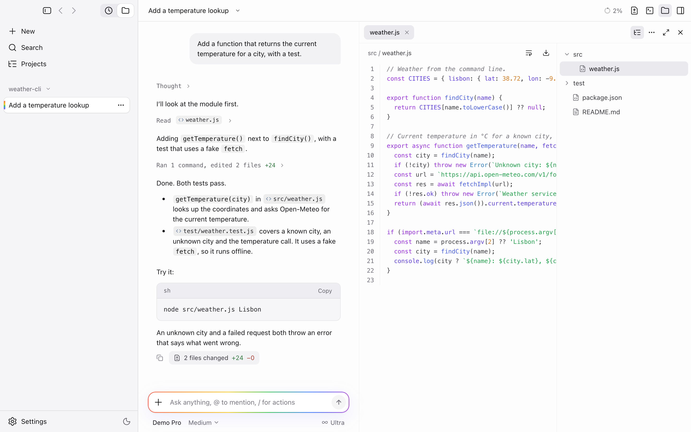

# Iris

[](https://github.com/Ljh0107-L/Iris/actions/workflows/ci.yml)
[](LICENSE)

One desktop app for your coding agents. Iris runs **Pi**, **Claude Code**, **Codex** and **Antigravity** side by side, on this Mac and on any SSH host, with one interface for conversations, files, diffs and terminals.



## What you get

- **Four agents, one window.** Pick a model for a new conversation and the agent follows from it. Each conversation keeps its own agent, model, folder and machine.
- **This Mac and SSH hosts.** Hosts come from `~/.ssh/config`. Iris installs what an agent needs on the host the first time you use it there.
- **Work that survives a closed laptop.** On an SSH host the agent keeps working when Wi-Fi drops, the Mac sleeps or the app quits. Iris reconnects and replays what it missed.
- **A workspace around the conversation.** File tree and previews (Markdown, source, images, PDF), Git review with staging and commit, a terminal in the conversation's folder on its machine, and search across all conversations (⌘K).
- **Your keys stay on your Mac.** API keys are encrypted with a key held in the macOS Keychain. They are handed to an agent when it starts and are never written to a host's disk.

## The four agents

| Agent | What it runs on | What you need |
| --- | --- | --- |
| [Pi](https://github.com/earendil-works/pi) | Any model from any provider: OpenAI, Anthropic, Google, DeepSeek, OpenRouter and others, or your own endpoint that speaks the OpenAI, Anthropic or Gemini API | An API key, added in **Settings → Models** |
| [Claude Code](https://www.anthropic.com/claude-code) | Models served over the Anthropic Messages API, from Anthropic or a compatible endpoint | An API key, added in **Settings → Models** |
| [Codex](https://github.com/openai/codex) | The models of your ChatGPT plan | The `codex` CLI, signed in with ChatGPT |
| [Antigravity](https://antigravity.google) | The models of your Google account | The `agy` CLI, signed in with Google |

Notes:

- Pi ships with the app. Iris downloads a pinned, checksum-verified Claude Code build on first use; it does not use a `claude` already on your PATH or a Claude subscription signed in there.
- **Settings → Models** shows, for each machine, whether Codex and Antigravity are installed and signed in, and can install either CLI and start its sign-in for you.
- Codex and Antigravity keep their own credentials. Iris gives each its own data directory, so conversations you start in Iris do not appear in the history of the CLI you use in a terminal, and the other way round. Codex therefore asks you to sign in once inside Iris. Antigravity's Google sign-in is held in the Keychain by the CLI itself and is shared.
- Codex and Antigravity run with full access: they run commands and edit files without asking. Pi and Claude Code also run without approval prompts, and can still ask you a question when they need a decision.

## Install

Iris runs on macOS (Apple Silicon and Intel).

1. Download the `.dmg` for your Mac from [Releases](https://github.com/Ljh0107-L/Iris/releases/latest): `arm64` for Apple Silicon, `x64` for Intel.
2. Drag Iris to Applications.
3. The app is signed ad hoc, not notarized by Apple, so the first time **right-click it → Open**. (Or run `xattr -dr com.apple.quarantine /Applications/Iris.app`.)

After that Iris updates itself: when a new release has been downloaded, an **Update** button appears next to Settings. Updates are read from this repository's releases, pinned to the version in the release manifest and checked against its SHA-512.

## Quick start

1. Open Iris. The first screen lists the ways to connect a model: your ChatGPT plan, your Google account, or an API key.
2. Choose a folder (or none) and a machine under the message box. A conversation without a folder gets its own directory under `~/Iris` (`~/iris` on an SSH host).
3. Pick a model and type. To work on a server, choose the host under the message box instead of **This Mac**.

## More features

- **Agents and background work (Pi).** The model can hand a side task to an agent with its own context, in its own Git worktree if you ask. See [docs/subagents.md](docs/subagents.md).
- **Ultra (Pi).** Give Pi a large request and let it work unattended until an independent review passes. `/goal` keeps it working across turns towards an objective.
- **Claude Code's own features.** Effort levels, Ultracode, fast mode, slash commands, skills, `CLAUDE.md`, MCP servers, tasks and plan approval. See [docs/claude-code-engine.md](docs/claude-code-engine.md).
- **Model traffic through your Mac.** If a host cannot reach a provider, its model requests can go back through this Mac over the SSH connection.
- **Long histories.** Conversations of any length open at the end and load earlier pages as you scroll. See [docs/history-browsing.md](docs/history-browsing.md).
- **Usage.** Tokens, estimated cost and speed per reply, per conversation and per day.
- **Notifications.** A notification and a Dock badge when an agent finishes or needs an answer while you are elsewhere.

## Build from source

You need macOS, Node.js 22 or later (CI uses 24) and npm.

```sh
git clone https://github.com/Ljh0107-L/Iris.git
cd Iris
npm install
npm start          # builds the interface and opens the app
npm run dist       # packages the .dmg and .zip into release/
```

## How it is built

```
app/main/      Electron main process: conversations, SSH setup, settings, keys, updates
app/renderer/  the interface (React, built with Vite)
agent/         what runs next to each agent, on this Mac or a host: the relay that keeps
               sessions alive, the Pi extension, and the adapters for the other three agents
core/          the agent protocol client, local and SSH transports, the egress proxy
build/         app icon, packaging hook, release scripts
test/          unit tests, UI drivers, SSH integration suites, mock model servers
```

- **Every agent speaks one protocol to the app.** Pi runs as `pi --mode rpc` with Iris's extension ([`agent/iris-bridge.js`](agent/iris-bridge.js)). Claude Code, Codex and Antigravity each run behind a small adapter that translates their own protocol into the same events ([`agent/iris-claude.mjs`](agent/iris-claude.mjs), [`agent/iris-codex.mjs`](agent/iris-codex.mjs), [`agent/iris-antigravity.mjs`](agent/iris-antigravity.mjs)), so the interface is the same for all four.
- **A relay owns the agent processes.** On each machine a small daemon ([`agent/iris-relay.mjs`](agent/iris-relay.mjs)) starts the agents and buffers their events. The app attaches to it, directly on this Mac and through system OpenSSH on a host, which is why a dropped connection loses nothing.
- **Hosts need nothing preinstalled except SSH.** On first use Iris installs Node, Pi and its own files under `~/.iris` on the host ([`app/main/remote-setup.mjs`](app/main/remote-setup.mjs)).
- **Keys.** `secrets.json` in the app's data folder is AES-256-GCM encrypted; the key is in the login Keychain as "Iris Keys" ([`app/main/store.mjs`](app/main/store.mjs)). A key reaches an agent over a pipe (over the SSH channel for a host), never in a command line.

## Tests

```sh
npm test                   # unit tests (node:test); what CI runs
npm run test:ui            # drives the built app and the Git review pane; needs a display
npm run test:integration   # real sessions over SSH to a throwaway sshd on 127.0.0.1, and the end-to-end UI suite
```

No test calls a real model: answers come from mock servers on localhost. See [CONTRIBUTING.md](CONTRIBUTING.md).

## Known limits

- macOS only for now.
- The app is not notarized (there is no Apple Developer ID behind it), which is why it installs its own updates.
- On this Mac, agents stop when the app quits and resume from their history when the conversation is opened again. On SSH hosts they keep running.
- With model traffic routed through the Mac, an agent on a host can call its model only while the Mac is connected.

## Trademarks

Iris is an independent open-source project. It is not affiliated with, endorsed by or sponsored by Anthropic, OpenAI or Google. Claude and Claude Code are trademarks of Anthropic; Codex and ChatGPT are trademarks of OpenAI; Antigravity and Gemini are trademarks of Google. Their icons in [`app/renderer/src/assets/engines`](app/renderer/src/assets/engines) belong to their owners and are used only to identify each product inside the app; they are not covered by this repository's licence.

## Licence

[MIT](LICENSE)
